# Project-Based Learning: Building a Minimal LLM Inference Engine & Custom Kernels from Scratch

> **For agentic workers:** REQUIRED SUB-SKILL: Use superpowers:subagent-driven-development (recommended) or superpowers:executing-plans to implement this plan task-by-task. Steps use checkbox (`- [ ]`) syntax for tracking.

> [!tip] Terkait (Graph)
> - [[inference-engineering/inference-engineering-theory-and-practice|Inference Engineering: Theory, Systems Architecture, and Industry Best Practices]]
> - [[inference-engineering/kernels-custom-kernels-fusion|GPU Kernels, Custom Kernels, and Kernel Fusion]]
> - [[inference-engineering/deepseek_hardware_software_stack|DeepSeek Hardware–Software Inference Stack]]
> - [[inference-engineering/dflash-to-dspark-speculative-decoding|DFlash to DSpark: Speculative Decoding & SGLang Serving]]

**Goal:** Membangun LLM Inference Engine minimal dari nol di macOS (Apple Silicon) menggunakan Rust, dimulai dari CPU reference pipeline berbasis candle, paged KV cache, continuous batching, server HTTP OpenAI-compatible, hingga akselerasi custom compute kernel (Metal/CUDA) yang terverifikasi secara numerik.

**Architecture:** Mengikuti arsitektur clean-seam dua lapis seperti [rvllm](https://github.com/ermolushka/rvllm): layer atas (scheduler, paged memory block pool, continuous batching, prefix caching, dan HTTP server) murni decoupled Rust code yang agnostik terhadap backend akselerator; layer bawah (tensor compute) dimulai dari candle CPU baseline, lalu digantikan oleh custom kernels (Metal Shading Language di macOS atau CUDA C++/NVRTC di remote GPU) dengan parity testing ketat pada setiap layer.

**Tech Stack:** Rust (`cargo`), `candle-core` (CPU tensor baseline), `tokenizers`, `axum` + `tokio` (async HTTP/SSE), `metal-rs` / MPS (macOS GPU compute), `cudarc` + NVRTC (opsional untuk remote Linux/Colab T4).

**Spec & Target Model Matrix:** Engine dirancang untuk mendukung tiga keluarga model berukuran compact (~350M parameters) untuk mendemonstrasikan evolusi arsitektur dari *pure dense Transformer* hingga *hybrid linear-attention / recurrent state*:

| Fitur Arsitektur | **SmolLM2-360M** (Hugging Face) | **Granite-4.0-350M** (IBM Dense / Hybrid) | **LFM2.5-350M** (Liquid AI Hybrid) |
| :--- | :--- | :--- | :--- |
| **Tipe Arsitektur** | Pure Dense Transformer (Llama) | **Dense**: Pure Llama-style Decoder<br>**Hybrid (`-h`)**: Mamba-2 + Transformer | Hybrid LIV Conv + GQA Attention |
| **Parameter & Precision** | 360M (F16 ~720MB, Q8_0 ~380MB) | 350M (F16 ~700MB, Q8_0 ~370MB) | 350M (F16 ~700MB, Q8_0 ~370MB) |
| **Layer Hierarchy** | 32 Transformer Layers | **Dense**: 28 Attention Layers<br>**Hybrid**: 4 Attention + 28 Mamba-2 | 16 Layers: 6 Attention + 10 LIV Conv |
| **Hidden Dim ($D$) / Heads** | $D=960$, $N_q=15$, $N_{kv}=3$ | **Dense**: $D=1024$, $N_q=16$, $N_{kv}=4$<br>**Hybrid**: $D=768$, $N_q=12$, $N_{kv}=4$ | $D=1024$, $N_q=16$, $N_{kv}=4$ (GQA blocks) |
| **Head Dim ($D_h$)** | 64 | 64 | 64 |
| **Vocab Size** | 49,152 | 49,152 | 65,536 |
| **Context Window** | 2,048 / 8,192 tokens | Hingga 32,768 tokens | Hingga 32,768 tokens |
| **KV Cache / token (F32)** | **48 KB** ($2 \times 32 \times 3 \times 64 \times 4$) | **Dense**: **56 KB** ($2 \times 28 \times 4 \times 64 \times 4$)<br>**Hybrid**: **8 KB** ($2 \times 4 \times 4 \times 64 \times 4$) | **~18 KB** ($2 \times 6 \times 4 \times 64 \times 4$) |
| **Memory Growth ($N$ tokens)** | $O(N)$ di seluruh layer | **Dense**: $O(N)$<br>**Hybrid**: $O(N)$ pada 4 layer + $O(1)$ SSM state | $O(N)$ pada 6 layer + $O(1)$ conv state |

---

## Global Constraints

- Platform lokal: macOS Apple Silicon (arm64, Darwin). Tidak mengasumsikan ketersediaan driver NVIDIA CUDA secara lokal; jalur GPU lokal menggunakan Metal / Unified Memory.
- Model scope & abstraction: Engine mengimplementasikan abstraction modular:
  1. **Phase 1–5 (Dense Baseline)**: `SmolLM2-360M` dan `Granite-4.0-350M (Dense)`. Keduanya berbasis Llama decoder (RMSNorm, RoPE, GQA, SwiGLU) dengan perbedaan konfigurasi dimensi ($D, L, N_q, N_{kv}$) yang di-parse dinamis dari header GGUF tanpa hardcoding.
  2. **Phase 6+ (Hybrid Extension)**: `LFM2.5-350M` dan `Granite-4.0-h-350M` yang memisahkan memori antara Paged KV Cache (sparse attention layers) dan Recurrent State Buffer ($O(1)$ conv/SSM state).
- Numerical verification: Setiap custom kernel dan model step wajib memverifikasi nilai aktivasi dan logits terhadap CPU reference path dengan batas toleransi absolut/relatif $\le 10^{-2}$.
- Paged Memory: Ukuran blok fisik KV cache $B_{\text{size}} = 16$ tokens, shape per blok: $[B_{\text{size}}, N_{kv}, D_h]$.
- Zero-copy layout: Reorder tensor RoPE/GQA dilakukan saat memuat bobot (load-time) ke format memori yang efisien, bukan runtime transposition berulang pada setiap step decode.

## Review Focus

1. **KV Cache Fragmentation & Eviction under OOM**: Saat pool blok fisik habis di tengah dekode multi-request, scheduler harus mem-preempt request paling lama (LRU) tanpa merusak block table request aktif lainnya.
2. **RoPE Dimension Re-ordering**: Format weight Q/K di GGUF sering kali menggunakan convention interleaved llama.cpp; pastikan dikonversi ke format rotate-half $[x_1 \dots x_{d/2}, x_{d/2+1} \dots x_d]$ saat model initialization agar tidak menghasilkan output gibberish.
3. **Prefill End Token Sampling**: Pastikan token terakhir dari fase prefill di-sample dan di-output dengan benar (tidak hilang atau tertelan sebelum decode step pertama dimulai).
4. **Shared Prefix Hit Boundary**: Saat request kedua menggunakan prefix cache yang sama, pastikan offset posisi RoPE (`position_offset`) dimulai dari token yang belum di-cache, bukan mengulang rotasi dari indeks 0.
5. **Backpressure & Client Disconnect**: Request yang dibatalkan oleh klien (koneksi putus saat SSE streaming) harus langsung membebaskan blok KV yang dialokasikan ke pool dan membatalkan slot di antrean.
6. **Hybrid Recurrent State vs Paged Memory Boundary**: Pada model hybrid (LFM2.5 / Granite-h), sequence yang di-preempt harus menyimpan snapshot state recurrent tetapnya ($O(1)$ buffer), sementara paged KV bloknya dibebaskan.

---

## Learning Path & Architecture Flow

```mermaid
flowchart TD
    subgraph Milestone 1: Multi-Model Config & Core Math
        M1A[GGUF Weight Loader: SmolLM2 & Granite-4.0] --> M1B[Unified Llama-family Forward Pass CPU]
        M1B --> M1C[Autoregressive Decode & Greedy/Top-P Sampler]
        M1C --> M1D[Parity Test vs llama.cpp / HF Reference]
    end

    subgraph Milestone 2: Paged Memory & Systems Hierarchy
        M2A[Physical Block Pool Allocator] --> M2B[Block Table Logical-to-Physical]
        M2B --> M2C[Prefix Caching Radix/Trie Hash]
        M2C --> M2D[Paged KV Gather & Write Logic]
    end

    subgraph Milestone 3: Scheduling & Serving
        M3A[Continuous Batching State Machine] --> M3B[Dynamic Admission & LRU Preemption]
        M3B --> M3C[Axum HTTP Server & SSE Streaming]
        M3C --> M3D[OpenAI-Compatible /v1/chat/completions]
    end

    subgraph Milestone 4: Kernel Engineering on Apple Silicon
        M4A[Naive vs Shared Memory Reduction] --> M4B[Custom Metal Shaders: RMSNorm & RoPE]
        M4B --> M4C[Fused SwiGLU Gate-Multiply Shader]
        M4C --> M4D[Paged Attention Gather & MPS GEMM Integration]
        M4D --> M4E[End-to-End Metal Parity & Benchmarking]
    end

    subgraph Milestone 5: Advanced Hybrid Architecture Extension
        M5A[LFM2.5 & Granite-h Recurrent State Modeling] --> M5B[Fixed-State O1 Buffer Allocator]
        M5B --> M5C[Sparse-Layer Paged Attention Integration]
        M5C --> M5D[Memory Footprint & Long-Context Benchmarks]
    end

    M1D --> M2A
    M2D --> M3A
    M3D --> M4A
    M4E --> M5A
```



## Tasks

### Task 1: Project Scaffolding & GGUF Weights Loader

**Files:**
- Create: `Cargo.toml`
- Create: `src/config.rs`
- Create: `src/weights.rs`
- Test: `tests/test_weights_loader.rs`

**Interfaces:**
- Consumes: GGUF model binary (`SmolLM2-360M.Q8_0.gguf`)
- Produces:
  ```rust
  pub struct ModelConfig {
      pub block_size: usize,
      pub hidden_size: usize,
      pub num_attention_heads: usize,
      pub num_key_value_heads: usize,
      pub num_hidden_layers: usize,
      pub intermediate_size: usize,
      pub vocab_size: usize,
      pub rms_norm_eps: f64,
  }

  pub struct ModelWeights {
      pub embed_tokens: candle_core::Tensor,
      pub layers: Vec<LayerWeights>,
      pub norm: candle_core::Tensor,
      pub lm_head: candle_core::Tensor,
  }
  ```

- [ ] **Step 1: Write the failing test**

```rust
// tests/test_weights_loader.rs
#[test]
fn test_load_model_configs_smollm2_and_granite() {
    let smol = mini_engine::config::ModelConfig::smollm2_360m();
    assert_eq!(smol.hidden_size, 960);
    assert_eq!(smol.num_attention_heads, 15);
    assert_eq!(smol.num_key_value_heads, 5);
    assert_eq!(smol.num_hidden_layers, 32);

    let granite = mini_engine::config::ModelConfig::granite_4_0_350m_dense();
    assert_eq!(granite.hidden_size, 1024);
    assert_eq!(granite.num_attention_heads, 16);
    assert_eq!(granite.num_key_value_heads, 4);
    assert_eq!(granite.num_hidden_layers, 28);
}
```

- [ ] **Step 2: Run test to verify it fails**

Run: `cargo test --test test_weights_loader`
Expected: FAIL (unresolved import or missing struct)

- [ ] **Step 3: Implement config parser & weight tensor loader in `src/config.rs` and `src/weights.rs`**

Menggunakan crate `candle-core` untuk parsing metadata GGUF (`llama.*` key), mengekstrak tensor F32/dequantized Q8_0, dan menata ulang Q/K weight matrix dari layout interleaved ke rotate-half layout.

- [ ] **Step 4: Run test to verify it passes**

Run: `cargo test --test test_weights_loader`
Expected: PASS

- [ ] **Step 5: Commit**

```bash
git add Cargo.toml src/config.rs src/weights.rs tests/test_weights_loader.rs
git commit -m "feat(core): setup project and implement GGUF weights loader"
```

---

### Task 2: CPU Autoregressive Transformer Forward Pass

**Files:**
- Create: `src/model.rs`
- Create: `src/sampler.rs`
- Test: `tests/test_forward_parity.rs`

**Interfaces:**
- Consumes: `ModelWeights`, `ModelConfig`, input token IDs `&[u32]`
- Produces:
  ```rust
  pub struct Model { /* weights & config */ }
  impl Model {
      pub fn forward_single_prompt(&self, tokens: &[u32]) -> Result<candle_core::Tensor, EngineError>;
      pub fn sample_next_token(&self, logits: &candle_core::Tensor, temperature: f32) -> Result<u32, EngineError>;
  }
  ```

- [ ] **Step 1: Write the failing test**

```rust
// tests/test_forward_parity.rs
#[test]
fn test_single_token_forward_produces_valid_vocab_logits() {
    let model = mini_engine::model::Model::load_mock_tiny(4, 16, 49152);
    let prompt = vec![101u32];
    let logits = model.forward_single_prompt(&prompt).expect("forward failed");
    assert_eq!(logits.dims(), &[1, 49152]);
}
```

- [ ] **Step 2: Run test to verify it fails**

Run: `cargo test --test test_forward_parity`
Expected: FAIL

- [ ] **Step 3: Implement forward pass in `src/model.rs`**

Implementasikan layer Transformer Llama:
$$\text{RMSNorm}(x) = \frac{x}{\sqrt{\frac{1}{d}\sum_{i=1}^d x_i^2 + \epsilon}} \odot \gamma$$
$$\text{RoPE}(x, m) = \begin{pmatrix} x_{2i} \cos(m\theta_i) - x_{2i+1} \sin(m\theta_i) \\ x_{2i} \sin(m\theta_i) + x_{2i+1} \cos(m\theta_i) \end{pmatrix}$$
$$\text{Attention}(Q, K, V) = \text{softmax}\left(\frac{Q K^T}{\sqrt{d_k}} + M\right) V$$
$$\text{SwiGLU}(x) = (\text{SiLU}(x W_{\text{gate}}) \odot (x W_{\text{up}})) W_{\text{down}}$$

- [ ] **Step 4: Run test to verify it passes**

Run: `cargo test --test test_forward_parity`
Expected: PASS

- [ ] **Step 5: Commit**

```bash
git add src/model.rs src/sampler.rs tests/test_forward_parity.rs
git commit -m "feat(model): implement CPU Llama forward pass and greedy sampler"
```

---

### Task 3: Paged KV Cache Block Pool & Block Table Allocator

**Files:**
- Create: `src/kv_cache/block_pool.rs`
- Create: `src/kv_cache/block_table.rs`
- Create: `src/kv_cache/prefix_cache.rs`
- Test: `tests/test_paged_kv_cache.rs`

**Interfaces:**
- Consumes: `block_size: usize`, `total_blocks: usize`
- Produces:
  ```rust
  pub type BlockId = usize;

  pub struct BlockPool {
      free_blocks: Vec<BlockId>,
      reference_counts: Vec<usize>,
  }

  pub struct BlockTable {
      pub blocks: Vec<BlockId>,
      pub num_tokens: usize,
  }

  impl BlockPool {
      pub fn allocate(&mut self) -> Option<BlockId>;
      pub fn free(&mut self, block: BlockId);
      pub fn increment_ref(&mut self, block: BlockId);
  }

  pub struct PrefixCache {
      pub fn find_longest_prefix(&self, tokens: &[u32]) -> (usize, Vec<BlockId>);
      pub fn insert_prefix(&mut self, tokens: &[u32], blocks: &[BlockId]);
  }
  ```

- [ ] **Step 1: Write the failing test**

```rust
// tests/test_paged_kv_cache.rs
#[test]
fn test_block_allocation_and_prefix_sharing() {
    let mut pool = mini_engine::kv_cache::BlockPool::new(10);
    let mut prefix_cache = mini_engine::kv_cache::PrefixCache::new();

    let b1 = pool.allocate().unwrap();
    let b2 = pool.allocate().unwrap();
    prefix_cache.insert_prefix(&[10, 20, 30, 40], &[b1, b2]);

    let (matched_tokens, shared_blocks) = prefix_cache.find_longest_prefix(&[10, 20, 30, 40, 50]);
    assert_eq!(matched_tokens, 4);
    assert_eq!(shared_blocks, vec![b1, b2]);
}
```

- [ ] **Step 2: Run test to verify it fails**

Run: `cargo test --test test_paged_kv_cache`
Expected: FAIL

- [ ] **Step 3: Implement memory manager and radix/hash prefix tree**

Bangun struktur data `BlockPool` berbasis LIFO free list, reference counting untuk Copy-on-Write (CoW) prefix blocks, dan `PrefixCache` yang memetakan hash token chunk ke daftar `BlockId`.

- [ ] **Step 4: Run test to verify it passes**

Run: `cargo test --test test_paged_kv_cache`
Expected: PASS

- [ ] **Step 5: Commit**

```bash
git add src/kv_cache/ tests/test_paged_kv_cache.rs
git commit -m "feat(kv-cache): implement paged block pool and prefix cache"
```

---

### Task 4: Continuous Batching Engine Loop & Iteration-Level Scheduler

**Files:**
- Create: `src/scheduler/sequence.rs`
- Create: `src/scheduler/mod.rs`
- Create: `src/engine.rs`
- Test: `tests/test_continuous_batching.rs`

**Interfaces:**
- Consumes: `Model`, `BlockPool`, `PrefixCache`
- Produces:
  ```rust
  pub enum SequenceStatus { Waiting, Running, Preempted, Finished }

  pub struct Sequence {
      pub id: u64,
      pub prompt_tokens: Vec<u32>,
      pub generated_tokens: Vec<u32>,
      pub block_table: BlockTable,
      pub status: SequenceStatus,
  }

  pub struct Engine {
      pub fn add_request(&mut self, prompt: &str, max_tokens: usize) -> u64;
      pub fn step(&mut self) -> Result<Vec<StepOutput>, EngineError>;
      pub fn has_unfinished_requests(&self) -> bool;
  }
  ```

- [ ] **Step 1: Write the failing test**

```rust
// tests/test_continuous_batching.rs
#[test]
fn test_continuous_batching_staggered_arrival() {
    let mut engine = mini_engine::engine::Engine::mock(4 /* max_running */);
    let id1 = engine.add_request("prompt 1", 5);
    
    // Step 1: prefill request 1
    let out1 = engine.step().unwrap();
    assert_eq!(out1.len(), 1);

    // Mid-generation arrival
    let id2 = engine.add_request("prompt 2", 5);

    // Step 2: request 1 decodes, request 2 prefills
    let out2 = engine.step().unwrap();
    assert_eq!(out2.len(), 2);
}
```

- [ ] **Step 2: Run test to verify it fails**

Run: `cargo test --test test_continuous_batching`
Expected: FAIL

- [ ] **Step 3: Implement step loop scheduler**

Implementasikan scheduler per-iterasi:
1. **Admit**: Periksa antrean waiting; alokasikan blok awal jika pool mencukupi.
2. **Execute**: Gabungkan prefill sequence dan decode sequence ke dalam satu batch forward call.
3. **Sample**: Hasilkan token berikutnya, tambahkan ke sequence.
4. **Retire/Preempt**: Jika sequence mencapai `max_tokens` atau `<|im_end|>`, bebaskan blok ke pool. Jika pool kekurangan blok saat ekspansi token baru, preempt request dengan LRU policy.

- [ ] **Step 4: Run test to verify it passes**

Run: `cargo test --test test_continuous_batching`
Expected: PASS

- [ ] **Step 5: Commit**

```bash
git add src/scheduler/ src/engine.rs tests/test_continuous_batching.rs
git commit -m "feat(scheduler): implement continuous batching engine loop"
```

---

### Task 5: OpenAI-Compatible HTTP Server (Axum + SSE Streaming)

**Files:**
- Create: `src/server/mod.rs`
- Create: `src/server/routes.rs`
- Create: `src/server/dto.rs`
- Modify: `src/main.rs`
- Test: `tests/test_server_sse.rs`

**Interfaces:**
- Consumes: `Engine` running in background tokio worker thread via mpsc channel
- Produces:
  ```rust
  pub async fn create_app(engine_sender: mpsc::Sender<EngineCommand>) -> axum::Router;
  // Endpoints:
  // POST /v1/chat/completions (JSON body, supports stream: true)
  // POST /v1/completions
  // GET  /health
  ```

- [ ] **Step 1: Write the failing test**

```rust
// tests/test_server_sse.rs
#[tokio::test]
async fn test_health_and_chat_completion_endpoint() {
    let app = mini_engine::server::test_app();
    let client = axum_test::TestServer::new(app).unwrap();

    let health = client.get("/health").await;
    health.assert_status_ok();

    let res = client.post("/v1/chat/completions")
        .json(&serde_json::json!({
            "model": "smollm2-360m",
            "messages": [{"role": "user", "content": "hi"}],
            "max_tokens": 2
        }))
        .await;
    res.assert_status_ok();
}
```

- [ ] **Step 2: Run test to verify it fails**

Run: `cargo test --test test_server_sse`
Expected: FAIL

- [ ] **Step 3: Implement Axum web server & background inference worker**

Implementasikan route handler, framing JSON SSE (`data: { ... }\n\ndata: [DONE]\n\n`), backpressure guard (return HTTP `429` saat `max_running + max_queue` penuh), dan deteksi `drop` koneksi klien untuk membatalkan inference token secara instan.

- [ ] **Step 4: Run test to verify it passes**

Run: `cargo test --test test_server_sse`
Expected: PASS

- [ ] **Step 5: Commit**

```bash
git add src/server/ src/main.rs tests/test_server_sse.rs
git commit -m "feat(server): add OpenAI-compatible HTTP server with SSE streaming"
```

---

### Task 6: Custom Kernel Engineering (macOS Metal Compute Shaders)

**Files:**
- Create: `src/metal/kernels/rmsnorm.metal`
- Create: `src/metal/kernels/rope.metal`
- Create: `src/metal/kernels/silu_gate.metal`
- Create: `src/metal/kernels/paged_kv.metal`
- Create: `src/metal/context.rs`
- Create: `src/metal/ops.rs`
- Test: `tests/test_metal_kernel_parity.rs`

**Interfaces:**
- Consumes: Raw Metal buffers (`id<MTLBuffer>`), compile via `MTLDevice::new_library_with_source`
- Produces:
  ```rust
  pub struct MetalContext {
      pub device: metal::Device,
      pub command_queue: metal::CommandQueue,
  }

  pub fn metal_rmsnorm(ctx: &MetalContext, input: &Buffer, weight: &Buffer, output: &mut Buffer, eps: f32);
  pub fn metal_rope(ctx: &MetalContext, q: &mut Buffer, k: &mut Buffer, pos_offset: usize);
  pub fn metal_silu_gate_multiply(ctx: &MetalContext, gate: &Buffer, up: &Buffer, out: &mut Buffer);
  pub fn metal_kv_gather(ctx: &MetalContext, paged_pool: &Buffer, block_table: &Buffer, out_contiguous: &mut Buffer);
  ```

- [ ] **Step 1: Write the failing test**

```rust
// tests/test_metal_kernel_parity.rs
#[test]
fn test_metal_rmsnorm_matches_cpu_reference() {
    let input_data = vec![1.0f32, 2.0f32, 3.0f32, 4.0f32];
    let weight_data = vec![1.0f32; 4];
    
    let cpu_result = mini_engine::ops::cpu_rmsnorm(&input_data, &weight_data, 1e-5);
    let metal_result = mini_engine::metal::ops::test_rmsnorm(&input_data, &weight_data, 1e-5);

    for (c, m) in cpu_result.iter().zip(metal_result.iter()) {
        assert!((c - m).abs() < 1e-4, "Mismatch: cpu {} vs metal {}", c, m);
    }
}
```

- [ ] **Step 2: Run test to verify it fails**

Run: `cargo test --test test_metal_kernel_parity`
Expected: FAIL

- [ ] **Step 3: Implement Metal compute shaders & kernel dispatch bindings**

Tulis MSL (Metal Shading Language) `.metal` compute shaders:
- **`rmsnorm.metal`**: Threadgroup parallel reduction untuk menghitung mean of squares, lalu normalisasi baris elemen.
- **`rope.metal`**: Rotasi vektor berpasangan $(x_{2i}, x_{2i+1})$ menggunakan sin/cos table precomputed.
- **`silu_gate.metal`**: Kernel fusion untuk $x \cdot \sigma(x) \times y$ dalam 1 memory write pass.
- **`paged_kv.metal`**: Scatter token baru ke blok fisik (`kv_write`) dan gather dari tabel blok fisik ke contiguous memory untuk attention calculation (`kv_gather`).

- [ ] **Step 4: Run test to verify it passes**

Run: `cargo test --test test_metal_kernel_parity`
Expected: PASS (pada host macOS dengan device Metal yang aktif)

- [ ] **Step 5: Commit**

```bash
git add src/metal/ tests/test_metal_kernel_parity.rs
git commit -m "feat(metal): implement custom compute shaders and parity test harness"
```

---

### Task 7: Benchmark Suite & Profiling Harness

**Files:**
- Create: `src/bin/bench.rs`
- Create: `docs/benchmarks.md`
- Test: `tests/test_benchmark_metrics.rs`

**Interfaces:**
- Consumes: Model checkpoint + Synthetic/Trace workload
- Produces:
  - Throughput metrics: `total tok/s`, `tok/s per request`, `decode ms/step`, `TTFT (first token ms)`
  - Memory metrics: `KV cache hit rate`, `pool utilization %`

- [ ] **Step 1: Write the failing test**

```rust
// tests/test_benchmark_metrics.rs
#[test]
fn test_bench_metric_calculation() {
    let report = mini_engine::bench::evaluate_run(
        /* total_tokens */ 128,
        /* total_duration_secs */ 2.0,
        /* num_requests */ 4,
    );
    assert_eq!(report.total_tokens_per_sec, 64.0);
    assert_eq!(report.tokens_per_sec_per_request, 16.0);
}
```

- [ ] **Step 2: Run test to verify it fails**

Run: `cargo test --test test_benchmark_metrics`
Expected: FAIL

- [ ] **Step 3: Implement benchmark CLI runner**

Buat harness benchmark di `src/bin/bench.rs` yang mengeksekusi sweep batch size ($1, 4, 8, 16, 32$) dengan prompt length 128 dan generation length 64, memisahkan prefill latency (TTFT) dari decode step duration.

- [ ] **Step 4: Run test to verify it passes**

Run: `cargo test --test test_benchmark_metrics`
Expected: PASS

- [ ] **Step 5: Commit**

```bash
git add src/bin/bench.rs docs/benchmarks.md tests/test_benchmark_metrics.rs
git commit -m "feat(bench): add automated benchmarking suite and metrics reporting"
```

### Task 8: Advanced Milestone: Hybrid State & Sparse KV Management (LFM2.5 & Granite-4.0-h)

**Files:**
- Create: `src/hybrid/recurrent_state.rs`
- Create: `src/hybrid/sparse_kv.rs`
- Modify: `src/scheduler/sequence.rs`
- Test: `tests/test_hybrid_memory.rs`

**Interfaces:**
- Consumes: `ModelConfig` dengan flags `is_hybrid`, `num_attention_layers`, `num_recurrent_layers`, `recurrent_state_dim`
- Produces:
  ```rust
  pub struct RecurrentState {
      pub states: Vec<candle_core::Tensor>, // Fixed O(1) buffer per recurrent layer
  }

  pub struct SparseBlockTable {
      pub attention_layers_blocks: Vec<Vec<BlockId>>, // Only allocated for attention layers
      pub num_tokens: usize,
  }

  impl RecurrentState {
      pub fn new_zeros(num_layers: usize, state_dim: usize) -> Self;
      pub fn reset(&mut self);
  }
  ```

- [ ] **Step 1: Write the failing test**

```rust
// tests/test_hybrid_memory.rs
#[test]
fn test_sparse_kv_cache_allocates_only_for_attention_layers() {
    // Granite-4.0-h: 4 attention layers out of 32 total layers
    let config = mini_engine::config::ModelConfig::granite_4_0_h_350m();
    let mut pool = mini_engine::kv_cache::BlockPool::new(100);
    let sparse_table = mini_engine::hybrid::SparseBlockTable::allocate_initial(&config, &mut pool);

    assert_eq!(sparse_table.attention_layers_blocks.len(), 4);
    assert_eq!(config.num_hidden_layers, 32);
    // Proves 85% block savings compared to allocating for all 32 layers
}
```

- [ ] **Step 2: Run test to verify it fails**

Run: `cargo test --test test_hybrid_memory`
Expected: FAIL

- [ ] **Step 3: Implement recurrent buffer management and selective block assignment**

Implementasikan pemisahan memori inferensi:
1. `RecurrentState`: buffer memori konstan $O(1)$ untuk layer konvolusi (LIV pada LFM2.5) atau Mamba-2 SSM (pada Granite-4.0-h) yang di-update in-place pada setiap token decode.
2. `SparseBlockTable`: membatasi alokasi blok fisik paged KV cache hanya pada layer yang memiliki modul GQA attention ($L_{\text{attn}} \ll L_{\text{total}}$), mengurangi memory footprint KV cache hingga $70\text{--}85\%$.

- [ ] **Step 4: Run test to verify it passes**

Run: `cargo test --test test_hybrid_memory`
Expected: PASS

- [ ] **Step 5: Commit**

```bash
git add src/hybrid/ src/scheduler/sequence.rs tests/test_hybrid_memory.rs
git commit -m "feat(hybrid): add recurrent state buffer and sparse layer KV management"
```

---

## Self-Review Checklist

- [x] **Spec coverage**: Mencakup semua komponen kunci: dynamic GGUF loader untuk multi-model (~350M class: SmolLM2, Granite-4.0, LFM2.5), Transformer Llama forward pass, Paged KV Cache block pool, Prefix Caching, Continuous Batching, OpenAI HTTP Server, Custom Metal Compute Shaders, dan Hybrid Recurrent State Management.
- [x] **Step scan**: Setiap step memiliki nama test, file, kode implementasi spesifik, perintah verifikasi shell yang dapat dieksekusi, dan pesan commit yang jelas.
- [x] **Type consistency**: Tipe data `BlockId`, `BlockPool`, `BlockTable`, `Sequence`, `RecurrentState`, `SparseBlockTable`, dan `ModelConfig` konsisten di seluruh task.
- [x] **Review Focus coverage**: 6 edge case dan failure modes (KV OOM, RoPE dimension ordering, prefill token emission, prefix offset, client disconnect, hybrid state preemption) diuji secara eksplisit pada Task 1, 2, 3, 4, 5, dan 8.
- [x] **macOS Realism**: Menggunakan CPU candle sebagai baseline yang dapat langsung di-run di macOS, dan menargetkan Metal untuk akselerasi GPU lokal tanpa dependensi hardware NVIDIA CUDA lokal.
