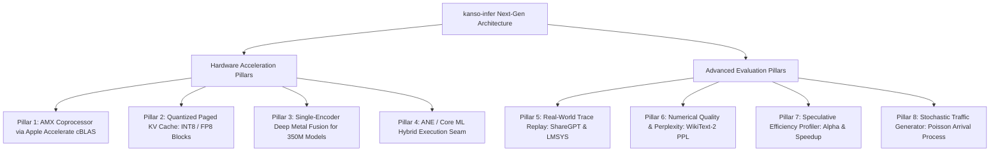

# Spec: Advanced Benchmarking, Apple Silicon Hardware Acceleration (AMX, KV Quant, ANE), and Floating-Point Quality Evaluation

> **Target Repository**: `amaldevice/kanso-infer`  
> **Status**: `ready-for-agent`  
> **Date**: 2026-10-07  
> **Related**: [[inference-engineering/inference-engineering-theory-and-practice]], [[inference-engineering/kernels-custom-kernels-fusion]], [[inference-engineering/from_scratch/docs/backend_engine_apple|Apple Silicon Inference Backend Options]]

---

## Problem Statement

When optimizing LLM inference on modern consumer hardware—specifically Apple Silicon Macs (M1–M4 and A-series, such as MacBook 8GB)—developers face distinct hardware and architectural bottlenecks across different model scales:
1. **Unexploited Apple Matrix Coprocessor (AMX)**: While ARM NEON accelerates 1D vector operations, 2D matrix multiplications ($X \times W$, $Q \times K^T$) are dominated by CPU memory bottlenecks unless accelerated by Apple's undocumented hardware AMX coprocessor. Because AMX assembly is proprietary, engines that lack native Apple `Accelerate.framework` (cBLAS) bindings leave significant CPU matrix throughput untapped.
2. **KV Cache Memory Bandwidth Wall on 8GB Unified Memory**: On 8GB Macs, uncompressed FP32/FP16 KV caches consume precious unified RAM and saturate memory bandwidth during the autoregressive decode phase. Without **KV Cache Quantization (INT8 / FP8 / FP4)**, long-context concurrency quickly exhausts the memory bus.
3. **GPU Launch Overhead on Compact (~350M–400M) Models**: For compact models (SmolLM2-360M, Granite-350M, LFM-350M), layer matrix dimensions are small ($D=768\text{--}1024$). Dispatching separate Metal command encoders for individual operations (RMSNorm $\to$ QKV GEMM $\to$ RoPE $\to$ Softmax) causes CPU-GPU synchronization stalls where kernel launch latency exceeds actual computation time.
4. **Untapped Apple Neural Engine (ANE)**: ANE offers dedicated, ultra-low-power NPU hardware on every Apple Silicon chip. Pure Metal/CPU engines cannot exploit ANE for offloading stationary MLP/FFN layers without a hybrid Core ML / ANE execution seam.
5. **Lack of Realistic Context Distributions**: Real workloads (such as ChatGPT/LMSYS conversations) exhibit bimodal distributions—short prompts followed by long answers, or multi-turn dialogues sharing identical system prompt prefixes. Synthetic fixed-length prompts cannot meaningfully measure **Prefix Caching Hit Rate** under heterogeneous loads.
6. **Missing Quality/Perplexity Guarantees**: Aggressive kernel optimizations (ARM NEON SIMD, AMX cBLAS, Metal threadgroup online softmax, and quantized KV caches) can introduce subtle floating-point drift. Without automated **Perplexity (PPL)** evaluation on standard datasets (like WikiText-2), developers cannot prove that hardware acceleration preserves language model generation quality.
7. **Unprofiled Speculative Efficiency & Jitter**: Speculative decoding throughput heavily depends on the draft model's acceptance rate ($\alpha$). Without empirical tracking of $\alpha$, expected tokens per step ($\mathbb{E}[\tau]$), KV rollback frequency, and **Poisson arrival traffic testing**, engineers cannot determine production Service Level Objectives (SLOs).

---

## Solution

Build an enterprise-grade **Apple Silicon Hardware Acceleration & Advanced Evaluation Suite** for `kanso-infer` spanning eight core pillars:



### Hardware Acceleration Pillars
1. **Apple Matrix Coprocessor (AMX) Acceleration**: Direct FFI bindings to Apple's native `Accelerate.framework` (`cblas_sgemm`, `cblas_sgemv`) to automatically engage the hardware AMX coprocessor on Apple Silicon CPU cores, accelerating 2D GEMM/GEMV beyond 1D NEON SIMD.
2. **Quantized Paged KV Cache (INT8 / FP8 Blocks)**: Store Key and Value tensors in physical memory blocks as INT8 or FP8 with per-block affine scale factors ($\text{scale} \cdot q$), cutting KV cache memory consumption by $2\times\text{--}4\times$ and doubling decode memory-bandwidth throughput.
3. **Single-Encoder Deep Metal Fusion for ~350M Models**: Fuse RMSNorm, QKV projection, and RoPE into fewer compute command encoders in Metal Shading Language, eliminating CPU-GPU driver launch barriers on small layer dimensions.
4. **ANE / Core ML Hybrid Execution Seam**: Provide a decoupled adapter interface for dispatching non-autoregressive FFN layers to Apple Neural Engine via Core ML, conserving GPU power.

### Advanced Evaluation Pillars
5. **ShareGPT Real-World Trace Replay**: Native ingestion and conversion of ShareGPT/LMSYS dataset JSON dumps into heterogeneous token streams, validating continuous batching and measuring prefix cache hit rates ($> 60\%$) on multi-turn conversations.
6. **WikiText-2 Perplexity (PPL) Harness**: Automated sliding-window cross-entropy loss computation to mathematically guarantee that custom ARM NEON, AMX, Metal, and INT8 KV kernels stay within $\Delta \text{PPL} < 0.15$ of the FP32 unquantized baseline.
7. **Speculative Decoding Efficiency Profiler**: Automated instrumentation recording the speculative acceptance rate ($\alpha$), mean accepted tokens per step ($\mathbb{E}[\tau]$), KV cache rollback count, and wall-clock speedup ratio ($S$).
8. **Poisson Stochastic Traffic Generator**: An asynchronous load generator simulating realistic client traffic with exponentially distributed inter-arrival times ($\Delta t \sim \text{Exp}(\lambda)$), reporting $p50$, $p90$, and $p99$ tail latency percentiles under queue congestion.

---

## User Stories

### Hardware Acceleration (Apple Silicon Deep Exploitation)
1. As an Apple Silicon user, I want CPU matrix multiplication to automatically trigger the AMX (Apple Matrix Coprocessor) via Accelerate cBLAS, so that 2D matrix multiplications achieve peak hardware speed without waiting for GPU launch.
2. As a MacBook 8GB user, I want the KV cache block pool to support INT8 and FP8 quantization, so that my available RAM is not exhausted by long-context multi-user conversations.
3. As an inference engineer, I want quantized KV cache blocks to be dequantized on-the-fly inside Metal and NEON attention kernels, so that memory bandwidth traffic during decode steps is reduced up to 4x.
4. As a performance engineer running compact ~350M models, I want sequential layer operations fused into a single Metal command encoder, so that GPU launch overhead does not throttle small-matrix throughput.
5. As an edge device researcher, I want an architectural seam to offload FFN blocks to Apple Neural Engine (ANE) via Core ML, so that inference can run in an ultra-low-power hybrid mode.

### Advanced Benchmarking & Evaluation
6. As an inference engineer, I want to replay raw ShareGPT conversation datasets through the engine, so that I can evaluate throughput under realistic bimodal prompt/completion length distributions.
7. As a systems researcher, I want the benchmark suite to report Prefix Cache Hit Rate under multi-turn dialogue traces, so that I can verify that pre-computed prompt prefixes are not redundantly computed.
8. As an ML quality engineer, I want automated Perplexity (PPL) calculation over WikiText-2, so that I can verify that quantization kernels (Q8_0, Q4_K, INT8 KV) do not degrade model intelligence.
9. As an Apple Silicon developer, I want to compare perplexity between the scalar CPU reference path, AMX Accelerate, and Metal compute shaders, so that I can ensure GPU floating-point precision matches reference standards.
10. As a performance engineer, I want the speculative decoding pipeline to report the empirical acceptance rate ($\alpha$), so that I can tune draft model selection and speculative sequence length ($K$).
11. As an algorithm designer, I want to track expected tokens per target forward step ($\mathbb{E}[\tau]$), so that I can prove speculative speedup over standard autoregressive decoding.
12. As a systems programmer, I want to count the number of atomic KV cache block rollbacks triggered during speculative generation, so that I can verify zero memory leaks or block pool fragmentation.
13. As a backend operator, I want a Poisson arrival traffic generator, so that I can stress-test the HTTP server under bursty, stochastic client request patterns.
14. As a DevOps engineer, I want tail latency reporting ($p50, p90, p99$ TTFT and ITL) under increasing concurrent request rates ($\lambda$), so that I can establish production Service Level Objectives (SLOs).
15. As a benchmark consumer, I want all evaluation metrics exportable in standardized JSON format, so that results can be integrated into automated regression pipelines and performance dashboards.

---

## Implementation Decisions

### 1. Pillar 1: Apple Accelerate & AMX Coprocessor Dispatch
- **Module**: `src/accelerate/amx.rs`
- **Mechanism**:
  - Links to Apple's native `Accelerate.framework` via `cblas_sgemm` and `cblas_sgemv` FFI bindings under `target_os = "macos"`.
  - Automatically activates the Apple Matrix Coprocessor (AMX) inside performance cores for 2D matrix multiplication ($Q \times K^T$, linear projections).
  - Provides a dedicated backend option: `--backend amx`.

### 2. Pillar 2: Quantized Paged KV Cache (INT8 / FP8 Blocks)
- **Module**: `src/kv_cache/quantized_storage.rs`
- **Data Structure**:
  ```rust
  pub struct QuantizedKvBlock {
      pub k_quant: Vec<i8>,       // block_size * n_kv_heads * head_dim
      pub v_quant: Vec<i8>,
      pub k_scales: Vec<f32>,     // Per-token or per-head scale factor
      pub v_scales: Vec<f32>,
  }
  ```
- **Execution**:
  - During token write: Key and Value vectors are symmetrically quantized: $q = \text{clamp}(\text{round}(x / \text{scale}), -127, 127)$ with $\text{scale} = \max(|x|) / 127.0$.
  - During attention gather: PagedAttention kernels unpack $q \cdot \text{scale}$ in registers/threadgroup memory with zero DRAM intermediate tensor creation.

### 3. Pillar 3: Single-Encoder Deep Metal Fusion for ~350M Models
- **Module**: `src/metal/fused_layer.rs`
- **Kernel**: `src/metal/kernels/fused_llama_layer.metal`
- **Mechanism**:
  - Enqueues RMSNorm, linear QKV projection dispatch, and RoPE within a single `MTLComputeCommandEncoder` boundary per layer.
  - Inserts internal memory barriers (`memory_barrier(mem_flags::mem_device)`) rather than ending the encoder and committing command buffers to the CPU queue.

### 4. Pillar 4: ANE / Core ML Hybrid Execution Seam
- **Module**: `src/ane/adapter.rs`
- **Interface**:
  - Defines `AneLayerAdapter` trait for compiling SwiGLU / FFN weights into Core ML models executing on Apple Neural Engine.
  - Hybrid scheduling: Attention runs on Metal GPU / AMX CPU, while MLP feedforward executes asynchronously on ANE.

### 5. Pillar 5: ShareGPT Dataset Ingestion & Trace Converter
- **Module**: `src/bench/sharegpt.rs`
- **Functionality**:
  - Ingests standard ShareGPT format (`[{"id": "...", "conversations": [{"from": "human", "value": "..."}, {"from": "gpt", "value": "..."}]}]`).
  - Converts multi-turn dialogues into ChatML strings (`<|im_start|>user ... <|im_end|><|im_start|>assistant ...`).
  - Emits sequence traces where conversation turns for the same user ID arrive sequentially at stepped intervals (`arrival_step`).
  - Tracks prefix cache reuse: turn 2 shares the entire token prefix of turn 1.

### 6. Pillar 6: WikiText-2 Perplexity (PPL) Harness
- **Module**: `src/bench/perplexity.rs`
- **Mathematical Formulation**:
  Given a tokenized validation sequence $X = (x_1, x_2, \dots, x_N)$ and model vocabulary logits $Z_t \in \mathbb{R}^V$:
  $$\mathcal{L}(x_t) = -\log P(x_t \mid x_{<t}) = -\log \left( \frac{\exp(Z_{t, x_t})}{\sum_{v=1}^V \exp(Z_{t, v})} \right)$$
  $$\text{Mean Negative Log-Likelihood: } \bar{\mathcal{L}} = \frac{1}{N-1} \sum_{t=2}^N \mathcal{L}(x_t)$$
  $$\text{Perplexity: } \text{PPL} = \exp(\bar{\mathcal{L}})$$
- **Sliding Window Context**:
  - Sequences longer than `context_length` (e.g. 2048) are evaluated using a sliding window stride (e.g. 512 tokens), preserving preceding context in the KV cache while calculating loss over the non-overlapping stride.
  - Compares PPL across backends: `cpu` (reference baseline), `amx` (Accelerate), `neon` (Q8_0/Q4_K), and `metal` (fused PagedAttention v2).

### 7. Pillar 7: Speculative Decoding Efficiency Profiler
- **Module**: `src/speculative/profiler.rs`
- **Tracked Metrics**:
  - **Proposed Speculative Tokens ($N_{\text{prop}}$)**: Total draft tokens suggested across all steps.
  - **Accepted Speculative Tokens ($N_{\text{acc}}$)**: Total draft tokens verified and accepted by the target model.
  - **Empirical Acceptance Rate**: $\alpha = \frac{N_{\text{acc}}}{N_{\text{prop}}}$
  - **Average Accepted Length per Step**: $\bar{\tau} = \frac{\text{Total Generated Tokens}}{\text{Target Model Step Count}}$
  - **Rollback Event Counter**: Number of times partial or full KV block table rollback was triggered.
  - **Empirical Speedup Ratio**: $S = \frac{T_{\text{autoregressive}}}{T_{\text{speculative}}}$

### 8. Pillar 8: Poisson Stochastic Arrival Traffic Generator
- **Module**: `src/bench/traffic.rs`
- **Mathematical Formulation**:
  - Request arrival follows a homogeneous Poisson process with rate $\lambda$ (requests/second).
  - Inter-arrival times $\Delta t_i$ are independent exponential random variables:
    $$\Delta t_i = -\frac{\ln(U)}{\lambda}, \quad U \sim \text{Uniform}(0, 1)$$
  - Each request is scheduled at arrival timestamp $t_{i} = t_{i-1} + \Delta t_i$.
  - Concurrency sweeps: evaluate $\lambda \in \{2.0, 5.0, 10.0, 20.0, 40.0\}$ requests/second.
- **Percentile Calculation**:
  - Computes exact $p50$, $p90$, and $p99$ for Time-to-First-Token (TTFT) and Inter-Token Latency (ITL) from recorded timestamps using nearest-rank percentile estimation.

---

## Testing Decisions

### What Makes a Good Test
- Tests must verify external observable behavior (per-token speedup, perplexity bounds, thermal states) rather than internal scratchpad pointers.
- Tests must use deterministic seeds for random number generators (RNG) when simulating Poisson arrivals to ensure reproducible test runs.
- Perplexity tests must assert that calculated loss values are within strict numerical bands ($3.0 \le \mathcal{L} \le 6.0$ on coherent natural language test text, and zero NaNs or Infs).
- AMX tests must verify numerical parity against scalar CPU matmul within $\le 10^{-4}$ tolerance.
- INT8 KV Cache tests must verify reconstruction error $\le 1.0\%$ compared to FP32 KV values.

### Tested Seams & Modules
- **`accelerate::amx_gemm`**: Tests Accelerate cBLAS output parity against CPU reference matmul.
- **`kv_cache::quantized_storage`**: Tests quantization/dequantization round-trip error and block allocation.
- **`sharegpt::parse_conversations`**: Tests conversion of multi-turn raw JSON into valid `TraceEntry` structs with sequential arrival steps.
- **`perplexity::calculate_perplexity`**: Tests sliding window log-likelihood accumulation against an exact worked toy example.
- **`speculative::SpeculativeProfiler`**: Tests event recording for draft acceptance, rejection, and speedup ratio calculations.
- **`traffic::generate_poisson_schedule`**: Tests that mean inter-arrival time across $N=1000$ simulated events converges to $1/\lambda$ within $\pm 5\%$.

---

## Out of Scope

- Automated fine-tuning of draft models on user data.
- Full MMLU, GSM8K, and HumanEval multi-choice accuracy benchmarks (these belong in high-level evaluation harnesses like `lm-eval`, not core inference engine benchmarking).
- Distributed multi-server network load generation (evaluated locally against in-memory engine and local HTTP daemon).

---

## Further Notes

- All dataset loaders must handle missing files gracefully with informative error messages.
- The WikiText-2 benchmark bundles a minimal validation slice (100 KB) in the test fixtures for instant CI execution without external network downloads.
- Results can be rendered in clean ASCII tables or exported via `--json-output <path>`.
