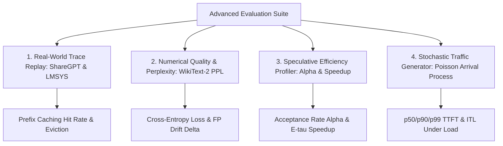

# Spec: Advanced Benchmarking, Real-World Trace Replay, and Floating-Point Quality Evaluation

> **Target Repository**: `amaldevice/kanso-infer`  
> **Status**: `ready-for-agent`  
> **Date**: 2026-10-07  
> **Related**: [[inference-engineering/inference-engineering-theory-and-practice]], [[inference-engineering/kernels-custom-kernels-fusion]]

---

## Problem Statement

While basic synthetic sweeps (`--batch-sizes 1,4,8` with uniform prompt lengths) measure raw hardware throughput, they fail to evaluate an LLM inference engine under real-world production constraints:
1. **Lack of Realistic Context Distributions**: Real workloads (such as ChatGPT/LMSYS conversations) exhibit bimodal distributions—short prompts followed by long answers, or multi-turn dialogues sharing identical system prompt prefixes. Synthetic fixed-length prompts cannot meaningfully measure **Prefix Caching Hit Rate** under heterogeneous loads.
2. **Missing Quality/Perplexity Guarantees**: Aggressive kernel optimizations (such as ARM NEON Q8_0/Q4_K integer quantization, Metal threadgroup online softmax, and fused activations) can introduce subtle floating-point drift. Without automated **Perplexity (PPL)** evaluation on standard datasets (like WikiText-2), developers cannot prove that hardware acceleration preserves language model generation quality.
3. **Unprofiled Speculative Efficiency**: Speculative decoding throughput heavily depends on the draft model's acceptance rate ($\alpha$). Without empirical tracking of $\alpha$, expected tokens per step ($\mathbb{E}[\tau]$), and memory rollback frequency, engineers cannot determine whether speculation provides a net speedup or introduces draft-model overhead.
4. **Deterministic Load Testing (Missing Traffic Jitter)**: Synchronous client batches do not model stochastic network traffic. Serving engines must be evaluated using **Poisson arrival processes** to stress-test queue saturation, Time-to-First-Token (TTFT) degradation, and Inter-Token Latency (ITL) percentiles under bursty concurrency.

---

## Solution

Build an enterprise-grade **Advanced Benchmarking and Evaluation Suite** for `kanso-infer` consisting of four core pillars:

1. **ShareGPT Real-World Trace Replay**: Native ingestion and conversion of ShareGPT/LMSYS dataset JSON dumps into heterogeneous token streams, validating continuous batching and measuring prefix cache hit rates ($> 60\%$) on multi-turn conversations.
2. **WikiText-2 Perplexity (PPL) Harness**: Automated sliding-window cross-entropy loss computation to mathematically guarantee that custom ARM NEON SIMD and Metal kernels stay within $\Delta \text{PPL} < 0.15$ of the FP32 unquantized baseline.
3. **Speculative Decoding Efficiency Profiler**: Automated instrumentation recording the speculative acceptance rate ($\alpha$), mean accepted tokens per step ($\mathbb{E}[\tau]$), KV cache rollback count, and wall-clock speedup ratio ($S$).
4. **Poisson Stochastic Traffic Generator**: An asynchronous load generator simulating realistic client traffic with exponentially distributed inter-arrival times ($\Delta t \sim \text{Exp}(\lambda)$), reporting $p50$, $p90$, and $p99$ tail latency percentiles under queue congestion.

---

## User Stories

1. As an inference engineer, I want to replay raw ShareGPT conversation datasets through the engine, so that I can evaluate throughput under realistic bimodal prompt/completion length distributions.
2. As a systems researcher, I want the benchmark suite to report Prefix Cache Hit Rate under multi-turn dialogue traces, so that I can verify that pre-computed prompt prefixes are not redundant computed.
3. As an ML quality engineer, I want automated Perplexity (PPL) calculation over WikiText-2, so that I can verify that quantization kernels (Q8_0, Q4_K) do not degrade model intelligence.
4. As an Apple Silicon developer, I want to compare perplexity between the scalar CPU reference path and Metal compute shaders, so that I can ensure GPU floating-point precision matches reference standards.
5. As a performance engineer, I want the speculative decoding pipeline to report the empirical acceptance rate ($\alpha$), so that I can tune draft model selection and speculative sequence length ($K$).
6. As an algorithm designer, I want to track expected tokens per target forward step ($\mathbb{E}[\tau]$), so that I can prove speculative speedup over standard autoregressive decoding.
7. As a systems programmer, I want to count the number of atomic KV cache block rollbacks triggered during speculative generation, so that I can verify zero memory leaks or block pool fragmentation.
8. As a backend operator, I want a Poisson arrival traffic generator, so that I can stress-test the HTTP server under bursty, stochastic client request patterns.
9. As a DevOps engineer, I want tail latency reporting ($p50, p90, p99$ TTFT and ITL) under increasing concurrent request rates ($\lambda$), so that I can establish production Service Level Objectives (SLOs).
10. As a benchmark consumer, I want all evaluation metrics exportable in standardized JSON format, so that results can be integrated into automated regression pipelines and performance dashboards.
11. As a CLI user, I want a unified `kanso bench` subcommand with intuitive flags (`--dataset sharegpt`, `--eval-ppl wikitext2`, `--arrival poisson`), so that all benchmarking modes are accessible without custom scripts.
12. As a researcher comparing engines, I want standardized metric definitions identical to `vLLM` and `llmperf`, so that `kanso-infer` numbers can be directly cited in comparative research papers.

---

## Implementation Decisions

### 1. Pillar 1: ShareGPT Dataset Ingestion & Trace Converter
- **Module**: `src/bench/sharegpt.rs`
- **Functionality**:
  - Parses standard ShareGPT format (`[{"id": "...", "conversations": [{"from": "human", "value": "..."}, {"from": "gpt", "value": "..."}]}]`).
  - Formats multi-turn dialogues into ChatML strings (`<|im_start|>user ... <|im_end|><|im_start|>assistant ...`).
  - Emits sequence traces where conversation turns for the same user ID arrive sequentially at stepped intervals (`arrival_step`).
  - Tracks prefix cache reuse: turn 2 shares the entire token prefix of turn 1.

### 2. Pillar 2: WikiText-2 Perplexity (PPL) Harness
- **Module**: `src/bench/perplexity.rs`
- **Mathematical Formulation**:
  Given a tokenized validation sequence $X = (x_1, x_2, \dots, x_N)$ and model vocabulary logits $Z_t \in \mathbb{R}^V$:
  $$\mathcal{L}(x_t) = -\log P(x_t \mid x_{<t}) = -\log \left( \frac{\exp(Z_{t, x_t})}{\sum_{v=1}^V \exp(Z_{t, v})} \right)$$
  $$\text{Mean Negative Log-Likelihood: } \bar{\mathcal{L}} = \frac{1}{N-1} \sum_{t=2}^N \mathcal{L}(x_t)$$
  $$\text{Perplexity: } \text{PPL} = \exp(\bar{\mathcal{L}})$$
- **Sliding Window Context**:
  - Sequences longer than `context_length` (e.g. 2048) are evaluated using a sliding window stride (e.g. 512 tokens), preserving preceding context in the KV cache while calculating loss over the non-overlapping stride.
  - Compares PPL across backends: `cpu` (reference baseline), `neon` (Q8_0/Q4_K), and `metal` (fused PagedAttention v2).

### 3. Pillar 3: Speculative Decoding Efficiency Profiler
- **Module**: `src/speculative/profiler.rs`
- **Tracked Metrics**:
  - **Proposed Speculative Tokens ($N_{\text{prop}}$)**: Total draft tokens suggested across all steps.
  - **Accepted Speculative Tokens ($N_{\text{acc}}$)**: Total draft tokens verified and accepted by the target model.
  - **Empirical Acceptance Rate**: $\alpha = \frac{N_{\text{acc}}}{N_{\text{prop}}}$
  - **Average Accepted Length per Step**:
    $$\bar{\tau} = \frac{\text{Total Generated Tokens}}{\text{Target Model Step Count}}$$
  - **Rollback Event Counter**: Number of times partial or full KV block table rollback was triggered.
  - **Empirical Speedup Ratio**:
    $$S = \frac{T_{\text{autoregressive}}}{T_{\text{speculative}}}$$

### 4. Pillar 4: Poisson Stochastic Arrival Traffic Generator
- **Module**: `src/bench/traffic.rs`
- **Mathematical Formulation**:
  - Request arrival follows a homogeneous Poisson process with rate $\lambda$ (requests/second).
  - Inter-arrival times $\Delta t_i$ are independent exponential random variables:
    $$\Delta t_i = -\frac{\ln(U)}{\lambda}, \quad U \sim \text{Uniform}(0, 1)$$
  - Each request is scheduled at arrival timestamp $t_{i} = t_{i-1} + \Delta t_i$.
  - Concurrency sweeps: evaluate $\lambda \in \{2.0, 5.0, 10.0, 20.0, 40.0\}$ requests/second.
- **Percentile Calculation**:
  - Computes exact $p50$, $p90$, and $p99$ for Time-to-First-Token (TTFT) and Inter-Token Latency (ITL) from recorded timestamps using nearest-rank percentile estimation.

---

## Testing Decisions

### What Makes a Good Test
- Tests must verify external observable metrics rather than internal scratchpad pointers.
- Tests must use deterministic seeds for random number generators (RNG) when simulating Poisson arrivals to ensure reproducible test runs.
- Perplexity tests must assert that calculated loss values are within strict numerical bands ($3.0 \le \mathcal{L} \le 6.0$ on coherent natural language test text, and zero NaNs or Infs).
- Speculative profiler tests must verify that $\alpha \in [0.0, 1.0]$ and $\bar{\tau} \ge 1.0$.

### Tested Seams & Modules
- **`sharegpt::parse_conversations`**: Tests conversion of multi-turn raw JSON into valid `TraceEntry` structs with sequential arrival steps.
- **`perplexity::calculate_perplexity`**: Tests sliding window log-likelihood accumulation against an exact worked toy example.
- **`speculative::SpeculativeProfiler`**: Tests event recording for draft acceptance, rejection, and speedup ratio calculations.
- **`traffic::generate_poisson_schedule`**: Tests that mean inter-arrival time across $N=1000$ simulated events converges to $1/\lambda$ within $\pm 5\%$.

---

## Out of Scope

- Automated fine-tuning of draft models on user data.
- Full MMLU, GSM8K, and HumanEval multi-choice accuracy benchmarks (these belong in high-level evaluation harnesses like `lm-eval`, not core inference engine benchmarking).
- Distributed multi-server network load generation (evaluated locally against in-memory engine and local HTTP daemon).

---

## Further Notes

- All dataset loaders must handle missing files gracefully with informative error messages.
- The WikiText-2 benchmark can bundle a minimal validation slice (e.g. 100 KB) in the test fixtures for instant CI execution without external network downloads.
- Results can be rendered in clean ASCII tables or exported via `--json-output <path>`.
